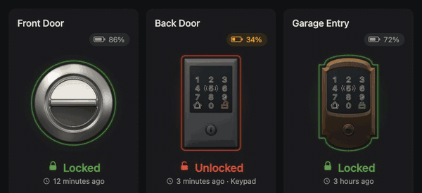
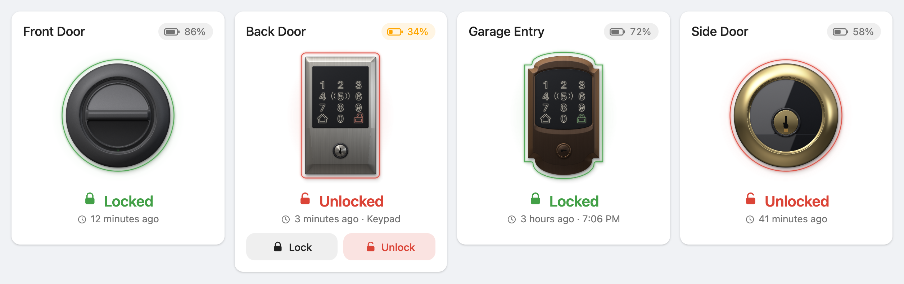
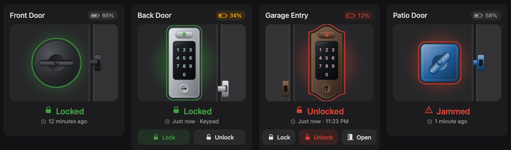

# Door Lock Card

An animated Lovelace card for Home Assistant smart locks. It draws the **Level Lock Pro**, the **Schlage Encode Plus** (Century and Camelot styles) and a generic deadbolt as lit renders, modelled on the real hardware, in any finish. The thumbturn turns with the light playing across it, the keypad wakes when you reach for it, and the lock catches the light as your pointer moves over it. You can also swap in your own images, GIFs or videos for each lock state.






## Features

- **Rendered, not drawn**: each lock is modelled on the manufacturer's product photos (the Level's sloped bezel, glass face and grip-bar knob; the Schlage's bevelled plate, outlined keypad and tapered lever) and lit by a small studio rig, so brushed nickel, polished brass and matte black each reflect light the way the material does. Nothing is a picture file, so it stays sharp at any size.
- **Made to be touched**: the thumbturn or key plug turns on a spring and lands with a small jolt, a ring of light and a glint. The lock presses in under your finger, and on a desktop the highlights follow your pointer. The Schlage keypad wakes when you reach for it and flashes when the lock confirms.
- **Clear status**: a fine glowing ring, and the lock key on the Schlage keypad, change color with the state. While a lock is locking or unlocking, a marching ring and a pulsing keypad show it's in progress. A jammed lock shakes.
- **Lock models, styles and views**: Level Lock Pro, Schlage Encode Plus (Century / Camelot) and a generic deadbolt (round / square). Each one can show the outside (exterior) or inside (interior).
- **Finishes and colors**: matte black, satin nickel, satin chrome, bright chrome, aged bronze, polished brass, satin brass, black stainless and white, or any custom color. The locked, unlocked, pending and jammed colors can all be changed.
- **Custom images**: give an image for each state (PNG, JPG, SVG, WebP, animated GIF, MP4 or WebM). Images change with a fade, slide, zoom or flip.
- **Battery level**: found automatically from the lock's device (or set it yourself). Turns amber when the battery is getting low and red when it's low.
- **Lock status**: uses Home Assistant's own translations.
- **Last changed**: shown as relative time ("5 minutes ago"), clock time, or both. It also shows `changed_by` (for example "Keypad") when the integration reports it.
- **Instant feedback**: the card starts animating the moment you tap, even for cloud locks that take a few seconds to report back.
- **Optional confirmation**: "Tap again to unlock" before unlocking, locking, or both.
- **Three layouts**: vertical, horizontal and compact. Supports dark mode, the sections view and the visual editor.
- No dependencies and no build step: it's a single JavaScript file.

## Installation

### HACS (recommended)

1. Open **HACS → ⋮ → Custom repositories**.
2. Add `https://github.com/kedube/ha-door-lock-card` with category **Dashboard**.
3. Search for **Door Lock Card**, install it, then reload your browser.

### Manual

1. Copy `dist/door-lock-card.js` to `config/www/door-lock-card.js`.
2. Go to **Settings → Dashboards → ⋮ → Resources → Add resource**.
   - URL: `/local/door-lock-card.js`
   - Type: **JavaScript module**
3. Reload your browser.

## Quick start

Add a card from the dashboard editor and search for **Door Lock Card**. Everything can be set in the visual editor. In YAML:

```yaml
# Level Lock Pro (via Matter). Battery sensor is found automatically.
type: custom:door-lock-card
entity: lock.front_door
lock_type: level_lock_pro
view: interior
finish: matte_black
```

```yaml
# Schlage Encode Plus, Century style, with buttons and confirm-before-unlock
type: custom:door-lock-card
entity: lock.back_door
lock_type: schlage_encode_plus
lock_style: century
finish: satin_nickel
show_buttons: true
confirm: unlock
last_changed_format: both
```

```yaml
# Compact row for a dashboard sidebar
type: custom:door-lock-card
entity: lock.garage_entry
lock_type: schlage_encode_plus
lock_style: camelot
finish: aged_bronze
layout: compact
```

If you leave out `lock_type`, the card guesses it from the device's manufacturer and model (Level → Level Lock Pro, Schlage → Encode Plus, anything else → generic deadbolt).

## Options

| Option | Default | Description |
| --- | --- | --- |
| `entity` | **required** | A `lock.*` entity. |
| `name` | friendly name | Card title. |
| `lock_type` | auto | `level_lock_pro`, `schlage_encode_plus` or `deadbolt`. |
| `lock_style` | first style | Schlage: `century`, `camelot`. Deadbolt: `round`, `square`. Level: `round`. |
| `view` | per model | `exterior` (outside of the door) or `interior` (inside, with the thumbturn). Level and deadbolt default to `interior`; Schlage defaults to `exterior` (keypad). |
| `finish` | per model | `matte_black`, `satin_nickel`, `satin_chrome`, `bright_chrome`, `aged_bronze`, `polished_brass`, `satin_brass`, `black_stainless`, `white`, `custom`. |
| `color` | | Custom finish color (`"#2060a0"`, `[32, 96, 160]` or any CSS color). Setting it implies `finish: custom`. |
| `layout` | `vertical` | `vertical`, `horizontal` or `compact`. |
| `art_size` | 190 / 150 / 60 | Lock height in px (vertical / horizontal / compact). |
| `show_indicator` | `true` | Glowing status ring around the lock. |
| `show_name` | `true` | Show the card title. |
| `show_status` | `true` | Show the lock state ("Locked", "Unlocking…"). |
| `show_battery` | `true` | Show the battery chip (hidden if no battery is found). |
| `battery_entity` | auto | Battery `sensor` (percent) or `binary_sensor` (low/OK). |
| `battery_low_threshold` | `20` | At or below this % the chip turns red. Up to twice this value it's amber. |
| `show_last_changed` | `true` | Show when the state last changed. |
| `last_changed_format` | `relative` | `relative` ("5 minutes ago"), `absolute` ("3:42 PM") or `both`. |
| `show_changed_by` | `true` | Append the lock's `changed_by` attribute when available. |
| `show_buttons` | `false` | Lock / Unlock buttons (plus Open if the lock supports it). |
| `confirm` | `none` | `none`, `unlock`, `lock` or `both`. Requires a second tap within 4 s. |
| `code` | | Code sent with lock/unlock calls, for locks that need one. |
| `animation_duration` | `700` | How long the lock takes to turn, in ms. Set `0` to turn animations off. |
| `tap_action` | `toggle` | Any [standard action](https://www.home-assistant.io/dashboards/actions/). `toggle` locks or unlocks. |
| `hold_action` | `more-info` | Standard action. |
| `double_tap_action` | `none` | Standard action. |
| `locked_color` / `unlocked_color` / `pending_color` / `jammed_color` / `unavailable_color` | theme | Status colors. Default to Home Assistant's lock state colors. |
| `images` | | Per-state images (see below). |
| `image_transition` | `fade` | `fade`, `slide`, `zoom`, `flip` or `none`. |
| `image_fit` | `contain` | `contain`, `cover`, `fill` or `scale-down`. |

### Upgrading from the first version

The card now shows the lock on its own, so the door, frame and sliding bolt are gone. `show_door`, `door_side`, `door_color` and `frame_color` are no longer used; you can leave them in your YAML (they are ignored) or delete them.

## Custom images

Put your files in `config/www/` (served as `/local/…`) and list one per state:

```yaml
type: custom:door-lock-card
entity: lock.front_door
images:
  locked: /local/locks/front-locked.png
  unlocked: /local/locks/front-unlocked.png
  locking: /local/locks/front-locking.gif     # optional
  unlocking: /local/locks/front-unlocking.mp4 # optional, videos work too
  jammed: /local/locks/front-jammed.png       # optional
image_transition: flip
```

- Only `locked` and `unlocked` are needed. A state without an image falls back to the nearest match: `locking` uses `locked` (with a pulse), `unlocking` uses `unlocked`, `open` uses `unlocked`, and `jammed` uses `unlocked` (with a shake). States with images: `locked`, `unlocked`, `locking`, `unlocking`, `jammed`, `open`, `opening`, `unavailable`.
- **Videos** (`.mp4`, `.webm`, `.mov`) play muted. In the in-between states they loop. In the final states they play once and stop on the last frame. A short clip of your own lock turning makes a nice effect.
- **Animated GIFs** and animated SVGs play as normal.
- When images are set, they replace the built-in lock. Name, status, battery and last changed still show as usual.

## Notes for Level and Schlage owners

- **Level Lock Pro** joins Home Assistant through the **Matter** integration. Matter locks report `locking`/`unlocking`, which the card animates directly. The battery shows up as a separate sensor on the same device, which the card finds on its own.
- **Schlage Encode Plus** through the **Schlage** cloud integration reports the new state a few seconds after a command. The card shows "Locking…"/"Unlocking…" straight away and finishes the animation when Home Assistant confirms. If the lock never reports a change, the pending state clears after 30 s. Errors from the lock (for example a jam or a timeout) appear on the card for a few seconds.
- `last_changed` comes from Home Assistant, so it resets when Home Assistant restarts unless the integration restores state.

## Theming

Every color is a CSS custom property, so themes and [card-mod](https://github.com/thomasloven/lovelace-card-mod) can override them:

```yaml
card_mod:
  style: |
    :host {
      --dlc-locked: #00bfa5;
      --dlc-unlocked: #ff7043;
      --dlc-duration: 500ms;
    }
```

Available: `--dlc-locked`, `--dlc-unlocked`, `--dlc-pending`, `--dlc-jammed`, `--dlc-unavailable`, `--dlc-duration`. The card also respects `prefers-reduced-motion`: it turns off looping, pulsing and shaking animations but keeps the short transitions.

## Demo

Open `demo/index.html` in a browser to try every model, style, finish and layout against a simulated Home Assistant. You can tap the locks, switch states and toggle dark mode. No Home Assistant install is needed.

## Development

There is no build step: `dist/door-lock-card.js` is the source.

Every push and pull request runs the **Validate** workflow: HACS validation, a syntax check, a check of the version number, and a smoke test that opens the demo in headless Chrome and makes sure every lock renders and a tap locks and unlocks. To run the smoke test yourself:

```sh
npm install --no-save playwright-core
node .github/scripts/smoke.mjs
```

### Releasing

Versions run `0.01`, `0.02` … `0.99`, `1.00`, `1.01` … The number lives in the `VERSION` constant in `dist/door-lock-card.js`, and only the release workflow changes it.

To publish, run the **Release** workflow from the Actions tab and choose the bump:

| Bump | Effect | Examples |
| --- | --- | --- |
| `minor` | Adds 0.01, rolling 0.99 over to the next whole number. | 0.01 → 0.02, 0.99 → 1.00 |
| `major` | Goes straight to the next whole number. | 0.37 → 1.00, 1.05 → 2.00 |

Or from a terminal: `gh workflow run release.yml -f bump=minor`.

The workflow runs the same checks as Validate, writes the new version into the card, commits and tags it (`v0.01`), and publishes a GitHub release with `door-lock-card.js` attached. HACS offers that release as the update.

## Disclaimer

This project is not affiliated with or endorsed by Level Home or Allegion/Schlage. Product names are used only to describe which hardware the renders represent. The locks are generated by the card itself; they are not the manufacturers' product images and don't reproduce every detail of the hardware.

## License

[GPL-3.0](LICENSE)
